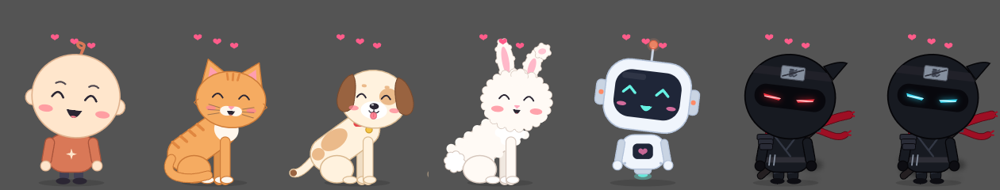

# ClaudeBuddy for Windows

A tiny desktop pet that lives on your taskbar and knocks on the glass when your AI coding agent — Claude Code,
Codex, or anything else — is done or needs your OK.



Windows port of [ClaudeBuddy for macOS](https://github.com/pooriaanv/claudBuddy-Mac) (v0.0.9), built with Tauri v2.

## Features

**It knocks when your agent needs you.** A finished turn or a permission prompt brings the buddy up to the glass:
it knocks three times (each character has its own knock sound) and shows who's waiting and in which project. Reply,
or click it, and it goes back to its spot. Several sessions at once are queued.


**Or right where it is.** Settings → Behavior → Knock: *Big, in the middle* or *Right where it is* (same spot and
size, just in front of every window).


**It has a life.** Sits, looks around, walks, dances, naps when you're away and wakes up with a yawn. Its eyes follow
your cursor. Click for hearts; drag it around and drop it — it falls back to the floor, and if you drop it on an app
it stays in front of that app until you use it. Every character meditates now and then; the ninjas practice kata,
kicks, shuriken and the sword.


**Quiet when you're watching** (optional): if the session runs in the Claude/Codex desktop app and you're already
looking at it, the buddy shows a small `✓ project` tag instead of knocking.

**Settings** — 7 characters, size, mischief (Calm / Playful / Naughty), sound, knock style, open at login,
English / فارسی, and one-click agent hooks.


## Install

Download `ClaudeBuddy_<version>_x64-setup.exe` from Releases and run it — it installs for your user only, no admin.
Then: tray icon → **Settings… → Agents → Connect** next to Claude Code (and/or Codex).

Connecting adds only the buddy's entries to `~/.claude/settings.json` (a `.buddy-backup` copy is kept); your other
hooks and settings are untouched. *Disconnect* removes them again.

Any other tool can knock too:

```bash
~/.claude-buddy/buddy-notify.exe <name> done '{"project": "my-app"}'
```

## Build

Node 22/24 LTS, Rust (MSVC toolchain), Visual Studio 2022 Build Tools with "Desktop development with C++", WebView2.

```bash
cd app
npm install
npm test
npm run tauri build    # → src-tauri/target/release/bundle/nsis/ClaudeBuddy_<version>_x64-setup.exe
```
