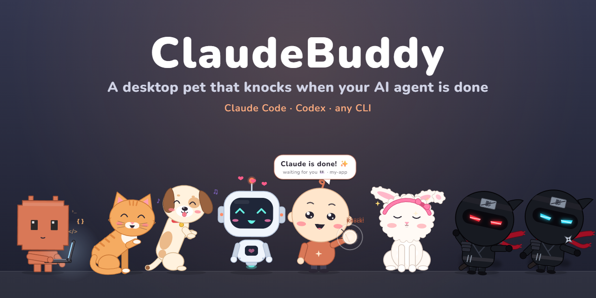
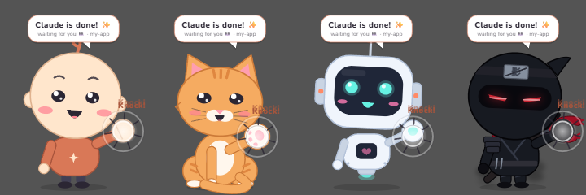
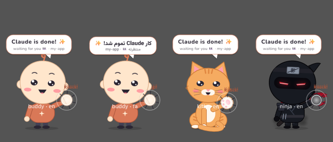
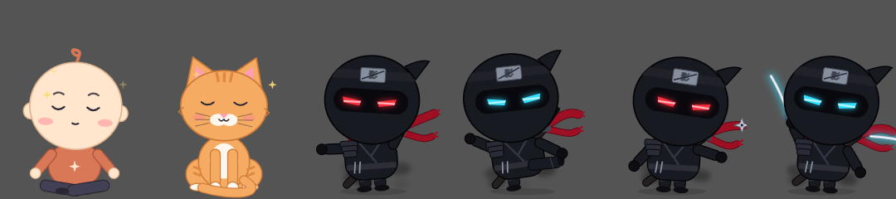
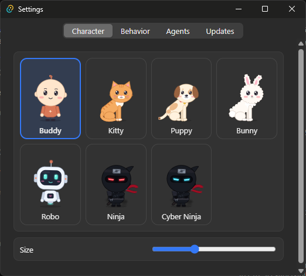

<div align="center">

# ClaudeBuddy

**A tiny desktop pet that knocks on your screen when your AI coding agent is done or needs your OK.**

[](https://github.com/pooriaanv/claudeBuddy/actions/workflows/ci.yml)
[](https://github.com/pooriaanv/claudeBuddy/security/code-scanning)
[](https://github.com/pooriaanv/claudeBuddy/actions/workflows/audit.yml)
[](https://github.com/pooriaanv/claudeBuddy/actions/workflows/ci.yml)
[](#testing)
[](https://github.com/pooriaanv/claudeBuddy/releases/latest)
[](https://github.com/pooriaanv/claudeBuddy/releases)
<br>


[](LICENSE)

Works with **Claude Code**, **Codex**, or any CLI · 8 characters · English / فارسی · self-updating

[⬇ Download](https://github.com/pooriaanv/claudeBuddy/releases/latest) · [What's new](CHANGELOG.md) · [Report a bug](https://github.com/pooriaanv/claudeBuddy/issues/new/choose)

</div>

It lives at the bottom of your screen, minds its own business while you work, and comes up to the glass when a
session finishes or asks for permission — so you can look away from the terminal without missing a beat.

## Features

**It knocks when your agent needs you.** A finished turn or a permission prompt brings the buddy up to the glass:
it knocks three times (each character has its own knock sound) and shows who's waiting and in which project. Reply,
or click it, and it goes back to its spot. Several sessions at once are queued.



**Or right where it is.** Settings → Behavior → Knock: *Big, in the middle* or *Right where it is* (same spot and
size, just in front of every window).



**It has a life.** Sits, looks around, walks, dances, naps when you're away and wakes up with a yawn. Its eyes follow
your cursor. Click for hearts; drag it around and drop it — it falls back to the floor. Drop it on an app and it
stays in front of all your windows; drop it on the desktop and it goes back behind them. Every character meditates
now and then; the ninjas practice kata, kicks, shuriken and the sword; Byte opens a laptop and codes.



**Quiet when you're watching** (optional): if the session runs in the Claude/Codex desktop app and you're already
looking at it, the buddy shows a small `✓ project` tag instead of knocking.

**Settings** — 8 characters, size, mischief (Calm / Playful / Naughty), sound, knock style, open at login,
English / فارسی, and one-click agent hooks.



## Install

**[⬇ Download the latest release](https://github.com/pooriaanv/claudeBuddy/releases/latest)** — it keeps itself up to date ([what's new](CHANGELOG.md)).

- **Windows:** run `ClaudeBuddy_<version>_x64-setup.exe` (installs for your user only, no admin). Windows may show
  "Windows protected your PC" (the installer isn't code-signed yet): **More info → Run anyway**.
- **macOS 14+**: open `ClaudeBuddy_<version>_universal.dmg` (Apple Silicon and Intel) or the smaller
  `ClaudeBuddy_<version>_aarch64.dmg` (Apple Silicon only) and drag ClaudeBuddy to Applications. The app isn't
  notarized: open it once, then **System Settings → Privacy & Security → Open Anyway**. It replaces an older
  ClaudeBuddy for Mac (same app id; the old copy is closed when the new one starts).
- **Linux** (x86_64; tested on Ubuntu 22.04, newer distros should work too): the `ClaudeBuddy_<version>_amd64.AppImage`
  (`chmod +x` it and run it; it updates itself) or the `.deb` (`sudo apt install ./ClaudeBuddy_<version>_amd64.deb`).
  Needs X11 or XWayland (a Wayland session runs it through XWayland automatically); the tray icon needs
  AppIndicator support (built into Ubuntu; on other GNOME desktops, the AppIndicator extension).

Then: tray / menu bar icon → **Settings… → Agents → Connect** next to Claude Code (and/or Codex).

Connecting adds only the buddy's entries to `~/.claude/settings.json` (a `.buddy-backup` copy is kept); your other
hooks and settings are untouched. *Disconnect* removes them again.

Something wrong? [Open an issue](https://github.com/pooriaanv/claudeBuddy/issues/new/choose) — it asks for the few
details that help.

Any other tool can knock too:

```bash
~/.claude-buddy/buddy-notify.exe <name> done '{"project": "my-app"}'   # Windows
~/.claude-buddy/buddy-notify <name> done '{"project": "my-app"}'       # macOS / Linux
```

## Development

```
app/
├─ src/            TypeScript, shared by every platform
│  ├─ core/        brain (what to do next), animation, attention queue, agent events, localization
│  ├─ render/      Canvas 2D: the 8 characters, bubble, effects, app icon
│  ├─ app/         pet controller, coordinator, preferences, tray menu, updater
│  └─ settings/    the settings window
├─ src-tauri/      Rust: windows, z-order and click-through (platform/{windows,macos,linux}.rs), hook installer,
│                  inbox, tray / menu bar
└─ notify/         Rust: buddy-notify, the tiny hook helper agents call
```

Needs Node 22/24 LTS and Rust. Windows: Visual Studio 2022 Build Tools ("Desktop development with C++"), WebView2.
macOS: Xcode Command Line Tools. Linux:
[Tauri's prerequisites](https://v2.tauri.app/start/prerequisites/#linux) (`libwebkit2gtk-4.1-dev`,
`libayatana-appindicator3-dev`, …).

```bash
cd app
npm install
npm run tauri dev      # run it
npm run tauri build    # Windows → bundle/nsis/*.exe; macOS → bundle/dmg/*.dmg; Linux → bundle/deb, bundle/appimage
```

`ClaudeBuddy --snapshot out.png en sheet` renders every character in every pose with the real renderer, which is
handy for checking a visual change.

### Testing

```bash
npm test                                            # TypeScript unit tests (Vitest)
npm run test:coverage                               # … with coverage
npm run build:notify                                # then the Rust tests:
cargo test --manifest-path notify/Cargo.toml        #   hook helper
cargo test --manifest-path src-tauri/Cargo.toml     #   app (hook installer, inbox, paths, …)
```

CI runs all of it on Windows, macOS and Linux for every push and pull request. The coverage badge measures the logic
(`src/core`, `src/app`): the brain, animation timing, attention queue, agent events, geometry, preferences and the
pet controller. The canvas drawing and the settings DOM aren't unit-tested; they're checked with `--snapshot`
previews and on a real desktop.

## License

[MIT](LICENSE)

ClaudeBuddy is an independent fan project — not affiliated with or endorsed by Anthropic. "Claude" is a trademark of
Anthropic.
